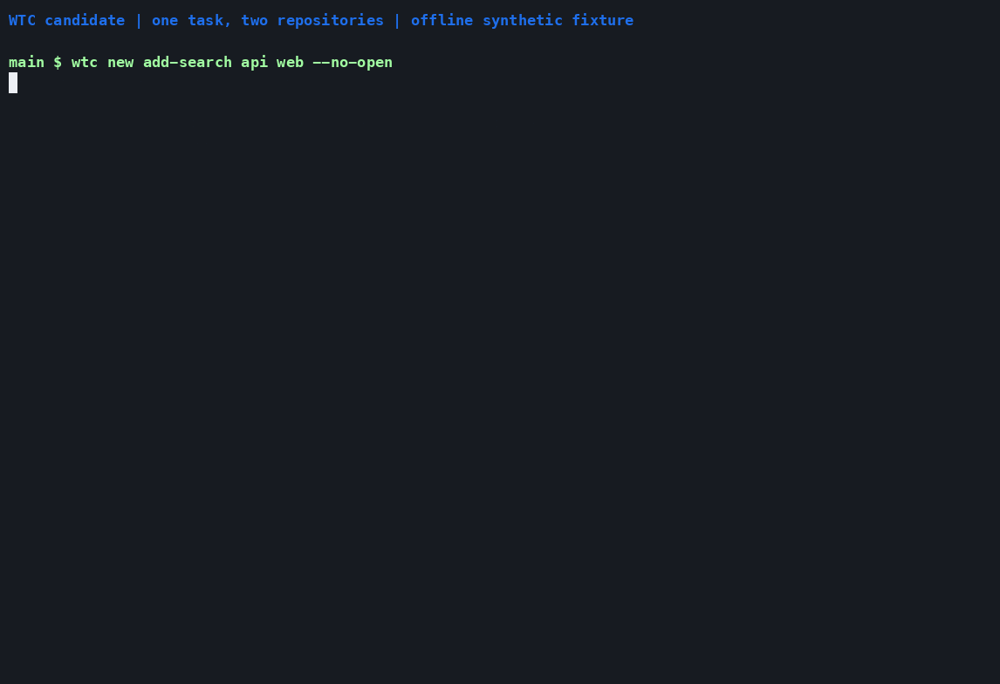

# wtc

**One task. One workspace. All your repositories.**

Git worktree collections for working across repositories, with agents or your favorite editor.

[](https://github.com/lcorneliussen/wtc-cli/releases)
[](https://github.com/lcorneliussen/wtc-cli/actions/workflows/ci.yml)

[Website and handbook](https://wtc.sh/) · [Getting started](https://wtc.sh/docs/getting-started/) · [Command reference](docs/commands.md) · [Releases](https://github.com/lcorneliussen/wtc-cli/releases)

A **worktree collection** puts the repositories needed for one task in a single
folder: your API, frontend, shared library, and optionally a project-owned
harness. Each repository keeps its own Git history. Start another task alongside
it with separate worktrees and ports.

WTC organizes the workspace, environment, agent guidance, and PR status. Your
projects keep their ordinary build and test commands. Agents, mise, and a special
editor are optional.

## Install and try it

You need Git and macOS or Linux. Download a [published binary](https://github.com/lcorneliussen/wtc-cli/releases), or use mise:

```sh
mise use -g github:lcorneliussen/wtc-cli@0.1.58
wtc --version
```

**Local terminal:** start in an empty folder and replace these synthetic repositories with your own:

```sh
mkdir fix-login && cd fix-login
wtc init
wtc add-repo git@github.com:example-org/api.git
wtc add-repo ~/code/web
wtc status
cd api
git switch -c fix-login
```

Worktrees start detached at their target branch; create a branch in each repository
you change before committing. No harness is required. Continue with the
[handbook](https://wtc.sh/docs/getting-started/) or the
[repository setup guide](docs/getting-started.md).

**OpenClaw gateway:** do not run `wtc init` or `wtc new`. Ask the agent to start
a managed collection. Read [Under OpenClaw](https://wtc.sh/docs/openclaw/) and
the [gateway integration reference](docs/openclaw.md). An agent setting up WTC
should start with [`wtc docs setup.md`](internal/wtc/defaults/setup.md).

## See it in action

Real commands against synthetic local repositories:

[](docs/demos/collections.gif)

[Transcript](docs/demos/collections.txt) · [Environment and secrets demo](docs/demos/inventories.gif) · [Minimal harness demo](docs/demos/harness.gif) · [Reproduce the recordings](docs/demos/README.md)

## Find the right documentation

| Need | Start here |
| --- | --- |
| Learn the workflows | [Website handbook](https://wtc.sh/docs/getting-started/) |
| Exact command options | [Command reference](docs/commands.md), `wtc <command> --help` |
| Set up a team harness | [Handbook](https://wtc.sh/docs/team-harness/), [harness design](docs/harness-design.md) |
| Configure hooks, environment, secrets, or services | [Embedded customization guide](internal/wtc/defaults/instructions/customize.md), `wtc docs` |
| Understand a release or upgrade | [Release notes and upgrades](docs/release-notes.md), `wtc release-notes --since <old-pin>` |
| Build, test, or contribute | [Development and validation](docs/development.md) |
| Report a bug | [Issues](https://github.com/lcorneliussen/wtc-cli/issues) — include version, host mode, and a redacted reproduction |

The website teaches workflows; this repository owns the detailed, versioned
contracts and canonical release notes. Embedded guidance matches the installed
binary. See [documentation ownership](docs/documentation-policy.md) for how
changes are reconciled across these surfaces.
