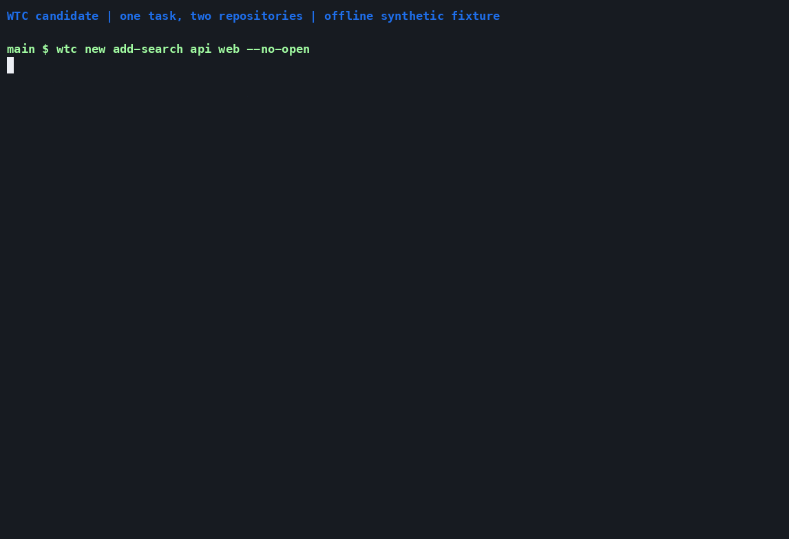

# taba

**One task. One workspace. All your repositories.**

Git worktree collections for working across repositories, with agents or your favorite editor.

taba was called wtc until 0.2. The `wtc` command keeps working, and existing collections, harnesses and pins need no changes; see the [rename announcement](https://taba.sh/wtc-is-now-taba/).

[](https://github.com/lcorneliussen/taba/releases)
[](https://github.com/lcorneliussen/taba/actions/workflows/ci.yml)

[Website and handbook](https://taba.sh/) · [Getting started](https://taba.sh/docs/getting-started/) · [Command reference](docs/commands.md) · [Releases](https://github.com/lcorneliussen/taba/releases)

A **worktree collection** puts the repositories needed for one task in a single
folder: your API, frontend, shared library, and optionally a project-owned
harness. Each repository keeps its own Git history. Start another task alongside
it with separate worktrees and ports.

taba organizes the workspace, environment, agent guidance, and PR status. Your
projects keep their ordinary build and test commands. Agents, mise, and a special
editor are optional.

## Install and try it

You need Git and macOS or Linux. Install with Homebrew, use mise, or download a [published binary](https://github.com/lcorneliussen/taba/releases):

```sh
brew install lcorneliussen/taba/taba
# or
mise use -g github:lcorneliussen/taba@0.2.0
taba --version
```

Every release installs both `taba` and `wtc`. They are the same program; examples below use `taba`.

**Local terminal:** start in an empty folder and replace these synthetic repositories with your own:

```sh
mkdir fix-login && cd fix-login
taba init
taba add-repo git@github.com:example-org/api.git
taba add-repo ~/code/web
taba status
cd api
git switch -c fix-login
```

Worktrees start detached at their target branch; create a branch in each repository
you change before committing. No harness is required. Continue with the
[handbook](https://taba.sh/docs/getting-started/) or the
[repository setup guide](docs/getting-started.md).

**OpenClaw gateway:** do not run `taba init` or `taba new`. Ask the agent to start
a managed collection. Read [Under OpenClaw](https://taba.sh/docs/openclaw/) and
the [gateway integration reference](docs/openclaw.md). An agent setting up taba
should start with [`taba docs setup.md`](internal/wtc/defaults/setup.md).

## See it in action

Real commands against synthetic local repositories:

[](docs/demos/collections.gif)

[Transcript](docs/demos/collections.txt) · [Environment and secrets demo](docs/demos/inventories.gif) · [Minimal harness demo](docs/demos/harness.gif) · [Reproduce the recordings](docs/demos/README.md)

## Find the right documentation

| Need | Start here |
| --- | --- |
| Learn the workflows | [Website handbook](https://taba.sh/docs/getting-started/) |
| Exact command options | [Command reference](docs/commands.md), `taba <command> --help` |
| Set up a team harness | [Handbook](https://taba.sh/docs/team-harness/), [harness design](docs/harness-design.md) |
| Configure hooks, environment, secrets, or services | [Embedded customization guide](internal/wtc/defaults/instructions/customize.md), `taba docs` |
| Understand a release or upgrade | [Release notes and upgrades](docs/release-notes.md), `taba release-notes --since <old-pin>` |
| The rename from wtc | [Environment compatibility](docs/rename-compatibility.md), [configuration inputs](docs/rename-config-inputs.md), [command names](docs/rename-invocation.md), [rename announcement](https://taba.sh/wtc-is-now-taba/) |
| Build, test, or contribute | [Development and validation](docs/development.md) |
| Report a bug | [Issues](https://github.com/lcorneliussen/taba/issues) — include version, host mode, and a redacted reproduction |
